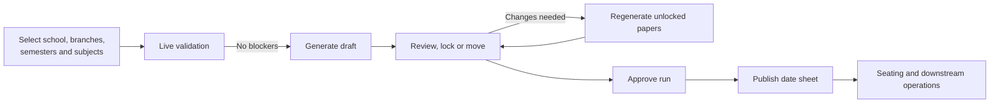
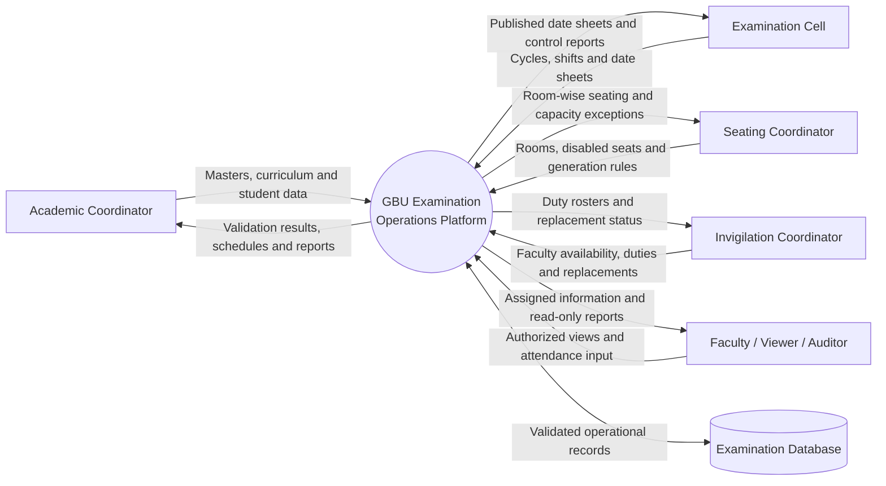
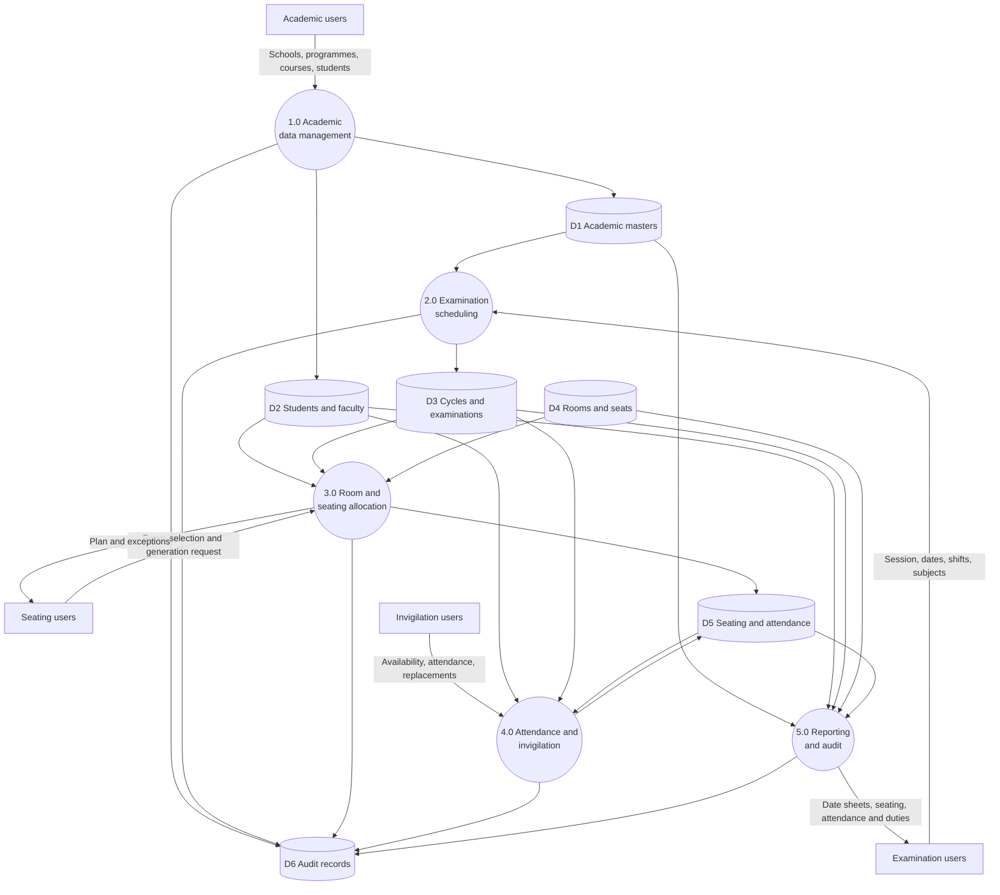
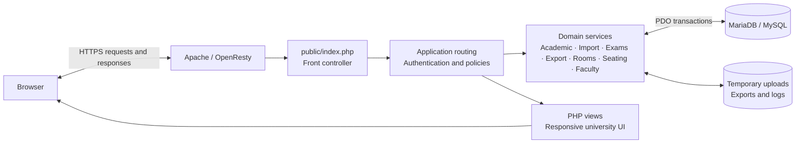

<div align="center">
  

  # Exam Scheduling and Management System

  **A role-governed university platform for curriculum management, automatic date-sheet generation, room-aware seating, attendance, invigilation, replacements, audit and reporting.**

  `PHP 8.2+` · `MariaDB / MySQL` · `Responsive & Accessible UI` · `CSV/XLSX Imports` · `Deterministic Scheduling` · `Branded Excel & Print Reports`
</div>

---

## About the application

The **Exam Scheduling and Management System** centralises the operational work required to conduct university examinations. It connects academic records, subject curricula, examination schedules, physical room layouts, student seating, attendance and faculty invigilation in one controlled workflow.

The system is designed for Gautam Buddha University and follows its school, programme and roll-number conventions. It replaces disconnected spreadsheets with validated imports, deterministic allocation, role-based access and an auditable record of operational changes.

### Core objectives

- Maintain reliable school, programme, subject, student, faculty and room master data.
- Build examination cycles, calendars, shifts and programme-wise date sheets.
- Model every physical seat and prevent disabled seats from being allocated.
- Generate reproducible room-wise seating plans with capacity exception reporting.
- Prepare attendance sheets, invigilation duties and replacement records.
- Produce university-ready print and CSV reports with a complete audit trail.

## Contents

- [System capabilities](#system-capabilities)
- [Academic progression](#academic-progression)
- [Latest updates](#latest-updates)
- [Faculty records and bulk import](#faculty-records-and-bulk-import)
- [Invigilation and replacements](#invigilation-and-replacements)
- [Faculty self-service portal](#faculty-self-service-portal)
- [Rooms and seating plans](#rooms-and-seating-plans)
- [Automatic date-sheet scheduling](#automatic-date-sheet-scheduling)
- [Operational workflow](#operational-workflow)
- [Data-flow diagrams](#data-flow-diagrams)
- [Architecture](#architecture)
- [Roles and access](#roles-and-access)
- [Data conventions](#data-conventions)
- [Database design](#database-design)
- [Local installation](#local-installation)
- [Upgrading an existing installation](#upgrading-an-existing-installation)
- [InfinityFree deployment](#infinityfree-deployment)
- [Demo data](#demo-data)
- [Testing](#testing)
- [Security](#security)
- [Reporting and printing](#reporting-and-printing)

## System capabilities

| Module | Implemented capabilities |
|---|---|
| Dashboard | Operational statistics, quick actions and role-aware navigation |
| Academic masters | Schools, departments, programmes, duration in semesters, admission-session batches, programme codes and validated programme CSV/XLSX import |
| Course structure | Batch-specific course name, code, credits, UG/PG level, academic year, semester, section, mid/end-semester duration, category, scheduling priority, active status and dependent programme/batch/semester filters |
| Students | Individual records, CSV/XLSX import, programme and lateral-entry detection, dependent directory filters and protected bulk deletion |
| Academic progression | Calendar-driven session/year/semester reconciliation, term history, course registrations, holds, delays, withdrawal and verified completion |
| Faculty | Required unique email, optional shared mobile number, generated internal IDs, school association, CSV/XLSX import preview and availability |
| Faculty portal | Linked personal accounts, duties, acknowledgments, room attendance, submission locks, closing reports and reviewed operational requests |
| Rooms | School ownership, bulk import, row/column geometry, disabled seats, usable-seat totals and standalone layout XLSX export |
| Examination cycles | Academic session, required student-batch selection, examination type, calendar dates, shifts and lifecycle status |
| Date sheets | Manual/import scheduling, school-wise automatic generation, batch-derived current semesters, branch/batch/subject selection, holidays, flexible gaps, priorities, live validation, locking, moving, regeneration, approval, publication and branded XLSX/detailed CSV export |
| Seating | Versioned paired-cohort allocation, school isolation, branch/paper separation, alternating-column fallback, capacity exceptions and university-format XLSX/print output |
| Attendance | Room-wise sheets and workbooks, attendance/UFM recording, revision checks, submission locks and reviewed corrections |
| Invigilation | Two invigilators per occupied room, missing-duty top-up, workload-based allocation, concurrent-request protection and cross-cycle/overnight conflict checks |
| Replacements | Faculty/coordinator requests, reviewer-selected replacements, availability checks, approval/rejection and retained duty history |
| Reports | Seating, attendance, date-sheet and operational CSV/print outputs |
| Governance | Eight application roles, CSRF protection, session control and audit logs |

## Academic progression

Student year, semester and session now advance automatically from the academic calendar, with term history, core-course registrations and individual exceptions. The new **Academic progression** screen provides calendar settings, future previews, current reconciliation and completion review. See [Academic progression operations](docs/ACADEMIC-PROGRESSION.md) for the upgrade, daily task and exception rules.

The default boundaries are **1 July** for a new academic session/odd semester and **1 January** for the even semester. Progression follows admission batch, programme duration and individual controls; it does not infer examination results. Holds and semester delays are supported, withdrawn students are excluded from regular cohorts, and students beyond normal programme duration await explicit completion verification. Historical examination placements, published eligibility, seating and attendance remain intact.

Core/common/bridge registrations follow matching active curriculum. A department elective selected for a regular date sheet registers the matching class; unscheduled alternatives are not assigned automatically. Back papers require explicit registrations. Missing curriculum is reported rather than invented.

## Latest updates

- **Faculty records and imports:** faculty creation/editing and CSV/XLSX imports share validation for active school, name, designation, required unique email, optional Indian mobile number and active/inactive status. Email is normalized; mobile numbers may be shared. New employee IDs are generated internally, while existing IDs and operational links are preserved. A downloadable template and normalized preview support the new format.

- **Two invigilators per room:** allocation fills each occupied published-seating room to two distinct active invigilators. Existing assignments are retained, retries add no duplicate duties, and legacy one-teacher rooms can be topped up. Coverage counts invigilator/senior-invigilator duties; observer duties do not satisfy room coverage. The queue shows covered rooms, missing-teacher actions, attendance links and completed coverage states.

- **Conflict-safe faculty operations:** allocation, availability changes and replacement approvals check actual examination times across cycles, including overnight overlaps. Concurrent operations lock faculty consistently. Faculty shortages roll back the allocation rather than saving a partial roster or changing workload counters.

- **Reviewed replacements:** coordinators can request a replacement with an optional suggestion, then select an active replacement when approving. Conflicting or unavailable faculty are rejected. The original duty stays assigned until approval; approval retains the old duty and creates the replacement assignment. Cancelled/replaced duties cannot expose student records through the faculty panel. The request register supports pending/approved/rejected filters.

- **Faculty self-service:** linked faculty accounts can acknowledge duties, mark assigned-room attendance, record UFM details, submit and lock attendance, send correction/availability/replacement requests and complete room-closing reports. Coordinator review controls reopening and operational changes.

- **Bulk student deletion:** open **Students → Bulk delete**, choose school, department, branch/programme, or all students, and review the matched/deletable/protected counts across all pages. Canonical master mappings and exact department/branch names saved on student records are available. A short-lived preview token and typed count confirmation limit deletion to the previewed group. Examination-linked students are retained; deletable students’ dependent progression/history rows follow the existing cascade policy. Successful deletions are audited and failures roll back.

- **Seat availability:** the Rooms directory shows available seats per room and for the currently filtered list, excluding blocked seats, inactive/maintenance rooms, and unavailable or unassigned schools. The seating generator scopes capacity to the selected session’s schools and shows room-wise available seats, planned allocation, and seats deliberately reserved for spacing.

- **Current pairing rule:** automatic pairing uses different branches within the same school, regardless of batch or year. Same-branch students never sit side by side. A shared course or course code on the exam day still blocks pairing. Alternating-column seating is the default fallback for a single branch or other unmatched groups; partner columns stay empty. Earlier saved plans retain their saved policy until regenerated.

- **No-pair fallback:** **Groups without a pair → Alternate columns · partner stays empty** is the default. Multiple unmatched groups can be seated without a valid year/branch/paper partner, using one usable column per empty column pair. Existing paired columns are preserved. The preview reports reserved columns, and saved-plan validation prevents filling them. Capacity shortages remain visible for review.

- **Room geometry Excel export:** each room card and seat-map page offers **Download layout Excel**, with the saved seat labels, blocked-position shading, desk/aisle layout, whiteboard and invigilator landmarks, capacity information, and landscape printing. It works before any seating allocation is generated.

- **Different papers for neighbouring students:** the automatic planner checks shared course/paper identity across the examination day, including another shift and separate branch examination records. Groups sharing a paper are excluded from pair suggestions. Neighbouring seat checks, safe remainder placement, manual corrections, and publication validation enforce the saved policy for new plans.

- **Branch separation in automatic seating:** suggestions and manual selections in the automatic planner pair different programmes only, including across batches and years. Allocation checks adjacent positions and desk partners in the saved usable room layout, swaps pair orientation when needed, and leaves unsafe leftover seats empty. New plans record this rule for publication validation; older saved versions keep their existing policy.

The current revision adds the following operational and UI improvements:

- **Remaining-student seating pairs:** each pair reserves equal student counts; fully paired cohorts are disabled in later selectors, while surplus students remain available. Pair arrows control allocation order, and optional room preferences control which rooms are tried first. Full rooms automatically overflow to other active rooms in the same school, and different pairs can share vacant desk pairs. The final remaining cohort in each school can either be seated automatically or left unallocated for review. Existing saved seating versions retain their original rules.
- **Automatic batch progression:** regular, mid-semester and end-semester cycles derive each selected batch's current semester from its admission years, programme duration, academic session and cycle date. Completed or not-yet-started batches are blocked from regular scheduling.
- **Batch-safe scheduling:** validation and generation retain a batch-to-semester snapshot so subjects from historical or future semesters cannot leak into a regular date sheet.
- **Programme bulk import:** administrators can download a CSV template, validate CSV/XLSX programme files, review valid and invalid rows, and commit only accepted records.
- **Improved curriculum import:** shortened batch-year aliases such as `UCS 2019-23` resolve to their canonical batch label, imported course status is retained, and preview screens show the normalized status.
- **Course register controls:** programme, batch and semester filters are dependent; course status can be changed from the register without recreating the curriculum mapping.
- **Selection-safe scheduling UI:** filtering branches, batches and semesters no longer resets deliberate subject selections.
- **Official Excel output:** published date sheets and generated scheduling runs can be exported as formatted `.xlsx` workbooks with the university identity, frozen headings, print layout and programme/batch/semester matrix.
- **Navigation refinement:** switching the desktop sidebar off now removes it completely, expands the workspace to full width and prevents hidden links from receiving keyboard focus. Mobile navigation remains an off-canvas drawer.

## Faculty records and bulk import

Use **Faculty → Add faculty** for individual records or **Bulk import** for CSV/XLSX files. Download the current template from the import page:

```csv
Name,School,Designation,Email,Mobile Number,Status
Sample Faculty,ICT,Assistant Professor,faculty@example.com,9876543210,active
```

- School accepts an active school's code, name or short name.
- Name, school, designation, valid email and status are required. Email must be unique across faculty records and within the import.
- Mobile Number is optional, including omission of the column. Supplied numbers are normalized from supported Indian formats and validated as ten-digit mobile numbers. Shared mobile numbers are allowed.
- Status is `active` or `inactive`. Employee IDs are generated internally for new records; editing preserves existing IDs and duty/account links.
- Review valid/invalid rows and normalized values before committing. Existing email matches are validation errors, not implicit updates.

Existing installations need the [faculty email upgrade](#upgrading-an-existing-installation) to enforce uniqueness in the database. Legacy missing emails remain until edited; new and edited records require a valid email.

## Invigilation and replacements

Publish a seating plan before allocating duties. **Invigilation** lists sessions, occupied rooms and the number of rooms with complete coverage. Each occupied room requires **two distinct active faculty members** with invigilator or senior-invigilator duties; observers do not count toward coverage.

**Auto-allocate** chooses available active faculty in workload order. **Allocate missing teachers** fills only missing positions, preserving existing assignments. Fully covered sessions show **All rooms covered**. Repeating allocation is safe. If insufficient faculty are available, the operation reports the shortage and rolls back its new assignments and workload updates.

Conflicts use actual start/end times across examination cycles, including overnight duties and overlapping unavailability. Adjacent sessions that do not overlap are allowed. A retained duty record for the same faculty/date/shift also prevents duplicate assignment. Unavailability cannot be approved or saved over an existing overlapping duty; reassign the duty first.

In **Replacement requests**, choose an active duty, record a reason and optionally suggest another active faculty member. Reviewers must select a replacement before approval. The server checks availability and overlapping duties again during approval. Approval cancels the original duty and creates a new assignment; rejection leaves the original assignment intact. Duplicate pending requests and repeated reviews are rejected. Filters expose pending, approved and rejected history, and the duty chart can be printed.

## Faculty self-service portal

An administrator links a user account to an active faculty record in **Users and roles**. Faculty sign-in opens the personal panel, scoped to that faculty member's duties.

- View and acknowledge duties; acknowledgment does not mark student attendance.
- Open assigned-room attendance within the configured window, record attendance and UFM information, and submit the room sheet. Revision checks reject stale updates.
- Submitted attendance is locked. A correction request requires coordinator approval to reopen it for a limited period.
- Submit a room-closing report with answer-book counts, handover, remarks and incident information.
- Request replacement or availability changes without silently changing an existing duty.
- Change the account password from the profile.

Authorized reviewers use **Faculty operations** to review requests and configure attendance settings. Cancelled or replaced duties no longer grant access to the room's student records. See `app/Faculty/FacultyPortalService.php` for the enforced access and submission rules.

## Rooms and seating plans

Each room belongs to a school. New rooms require explicit ownership; room imports accept School Code or a default school for older files. Student school is resolved from the canonical programme mapping. Unassigned rooms, inactive schools, inactive/maintenance rooms and blocked positions cannot supply usable seats. Spare seats in another school do not resolve a shortage.

For automatic seating, select a published examination session and pair compatible **different branches within the same school**, in any batch or year. Groups sharing a paper anywhere on the examination day are incompatible. Each pair reserves equal counts, surplus students remain available for subsequent pairs, and pair order controls allocation order. Preferred rooms are tried first, then other eligible rooms in the same school; different pairs can use remaining desk pairs.

The default unmatched-group fallback uses alternating columns with empty partner columns. These deliberately reserved positions remain protected in the preview, manual correction and publication checks. Capacity shortages remain in the unallocated report and prevent publication. Manual draft corrections require a reason. Published/superseded plans preserve their saved policy and assignments; regenerate to create a new version.

**Download layout Excel** exports a room's geometry without needing a seating allocation. Seating XLSX and print views use the university seating form, physical seat positions, desk/aisle landmarks, programme/batch summaries and accurate roll ranges. Earlier manual/year-based plans may retain older rules; the current automatic planner does not require first/third-year or second/final-year pairing patterns.

See [room school setup](docs/ROOM-SCHOOLS.md) for ownership upgrades. [Paired seating notes](docs/PAIRED-SEATING.md) describe the original manual-room workflow and export format; use the rules above for the current automatic planner.

## Automatic date-sheet scheduling

The automatic scheduler builds one independent date-sheet line for every selected **programme/branch and semester**. Papers from different branches may use the same date and shift when their own cohort rules allow it; they are not incorrectly combined into a single branch row.

### Scheduling workflow

1. Create an examination cycle with its date range, examination type, paper duration and shifts.
2. Mark Sundays, university holidays and any unavailable dates in **Calendar & holidays**.
3. Open **Automatic scheduling** and select one school.
4. Select only the programmes and admission batches belonging to that school. For regular, mid-semester and end-semester cycles, the application limits the scope to each active batch's calculated current semester.
5. Review the written subjects loaded for each selected branch, batch, semester and section. Eligible theory papers start selected and may be included or excluded individually; filter changes preserve those choices.
6. Set the preferred rest gap, daily paper limit, priority handling and non-consecutive-day preference.
7. Review live academic, calendar and feasibility checks, then save validation.
8. Generate the draft, lock important placements, move a paper when needed or regenerate unlocked papers.
9. Approve the reviewed run and publish the final date sheet.

### Scheduling rules

- Course priority uses values from 1 to 100; lower numbers are placed earlier when priority scheduling is enabled.
- Lab and practical subjects are automatically excluded from written date sheets.
- A requested gap is treated as a preference when the available examination window cannot accommodate it. The engine still attempts to schedule every valid selected paper.
- Sundays and configured holidays are unavailable unless explicitly enabled as examination days.
- Existing papers are preserved and shown during validation so a new branch can be added without silently replacing another branch's schedule.
- Locked papers keep their placement during regeneration; unlocked papers may be recalculated.
- Regular, mid-semester and end-semester cycles schedule only the semester appropriate to each active batch. Back-paper and special cycles may select historical semesters explicitly.
- Completed or not-yet-started batches are rejected from regular-cycle generation instead of silently producing incorrect papers.
- Student records are not required to build a draft date sheet. Eligibility counts remain zero until matching active students exist.
- Reopening Automatic Scheduling for an existing draft reconstructs the scope from the current database records. Its school, scheduled branches, semesters and written papers are selected automatically, including papers preserved from earlier runs.

### Draft lifecycle



## Operational workflow

```mermaid
flowchart LR
    A[Configure schools, programmes and durations] --> B[Create admission batches]
    B --> C[Add curriculum by batch, semester and section]
    C --> D[Import students and faculty]
    D --> E[Create rooms and visual seat layouts]
    E --> F[Select batches and create examination cycle]
    F --> G[Generate, review and publish school-wise date sheet]
    G --> H[Generate and review room-wise seating plan]
    H --> I[Publish room and attendance sheets]
    I --> J[Allocate invigilation duties]
    J --> K[Record attendance and replacements]
    K --> L[Export reports and review audit history]
```



## Data-flow diagrams

### DFD Level 0 — system context



### DFD Level 1 — internal examination flow



## Architecture



### Project structure

```text
Auto-Exam-Main/
├── app/
│   ├── Academic/       Roll-number, student-domain and batch-progression logic
│   ├── Auth/           Authentication and role policies
│   ├── Exams/          Examination scheduling services
│   ├── Export/         Dependency-free formatted XLSX generation
│   ├── Faculty/        Faculty portal, record validation, invigilation and migrations
│   ├── Foundation/     Application, database, session and environment
│   ├── Http/           Request and response abstractions
│   ├── Import/         CSV/XLSX staging, validation and commit services
│   ├── Rooms/          Physical seat generation
│   ├── Seating/        Seating allocation engine
│   ├── Support/        Shared application helpers
│   └── View/           View rendering
├── bootstrap/          Application bootstrap and autoloading
├── config/             Application and database configuration
├── database/           Canonical schema, seed, installer and backup utility
├── deployment/
│   └── infinityfree/   Hosting package builder and deployment guide
├── docs/               Scheduling design and date-sheet review notes
├── public/             Web entry point, CSS, JavaScript, icons and branding
├── resources/views/    Accessible server-rendered application screens
├── storage/            Imports, exports, logs and demonstration datasets
├── tests/              Unit, integration and end-to-end verification
├── tools/              Repeatable dataset and deployment builders
├── OPERATOR_GUIDE.md   Day-to-day operator instructions
├── DEPLOYMENT.md       Deployment overview
└── README.md           Project overview and setup guide
```

## Roles and access

| Role | Main responsibility |
|---|---|
| System Administrator | Full system, users, roles, masters, operations and audit control |
| Controller of Examinations | Examination cycles, date sheets, seating publication, attendance and reports |
| Academic Coordinator | Academic masters, curriculum and student records |
| Seating Coordinator | Rooms, disabled seats, layouts, seating generation and reports |
| Invigilation Coordinator | Faculty, availability, duties, replacements and attendance operations |
| Faculty / Invigilator | Personal duties, assigned-room attendance, closing reports and reviewed requests |
| Audit and Compliance Viewer | Read-only reports and audit history |
| Authorized Read-only Viewer | Dashboard and published operational reports |

Routes are checked against explicit permissions including `academic.manage`, `students.manage`, `faculty.manage`, `rooms.manage`, `exams.manage`, `seating.manage`, `attendance.manage`, `invigilation.manage`, `reports.view`, `audit.view`, `users.manage`, `faculty.self` and `faculty.review`. Faculty self-service additionally checks the linked faculty identity and assigned duty; review actions require coordinator authorization. Access is permission-based, including authorized non-administrator writes.

## Data conventions

### Student identifiers

The standard roll number contains nine characters:

```text
235UCS001
└┬┘└┬┘└┬┘
 │  │  └── Student sequence
 │  └───── Programme/branch code (UCS = B.Tech CSE)
 └──────── Admission identifier; first two digits represent admission year
```

Enrollment number is a separate ten-digit identifier, for example `2300100266`. Academic sessions use consecutive `YYYY-YYYY` format, such as `2026-2027`.

Student imports accept:

```text
Enrollment/Roll Number, Enrollment Number, Academic Session, Full Name,
Branch, Mobile Number, Address, Department, School,
Current Year of Study, Current Semester, Section
```

Mobile Number and Address may be blank or their columns omitted. A supplied mobile number must still be valid. Enter `Passout` (also accepts `Pass Out` or `Pass-Out`, case-insensitive) in year or semester to import a completed student with `pass_out` special status; the other field may be blank. For a mapped programme, the final programme year and semester are stored. Completed students remain completed during academic progression.

Lateral-entry roll codes replace `U` with `L`: `LCS` belongs to `UCS`, `LAI` to `UAI`, and likewise for other regular branches. Keep the original roll number and record the admission type as lateral, while using the regular programme for curriculum, exams and seating. The first two digits identify admission year: `235LCS001` was admitted in 2023 into second year of the regular UCS 2022–2026 class, alongside students with `225UCS…` rolls. Batch assignment subtracts one year for lateral admission and reuses that regular class, including batches with custom labels. Separate lateral programme entries are not required.

### Curriculum

Courses are associated with an exact programme batch, semester and section using a subject code, name and category. Use section `ALL` for subjects taken by the complete batch, or values such as `A` and `B` for section-specific papers. Automatic scheduling reads only the curriculum for batches assigned to the examination cycle and creates separate cohort rows for each batch/semester/section. The canonical seed currently provides **212 unique courses**, including **127 UCS curriculum mappings** across eight semesters; the standalone B.Tech CSE import fixture contains 94 valid curriculum rows and one intentionally rejected blank row.

Regular-cycle semester progression is derived from the cycle's academic session and date. Odd-session examinations select the odd semester for the batch's study year and even-session examinations select the even semester. Programme duration defines when a batch is complete.

### Rooms and disabled seats

Each room defines rows, columns and either `row_major` or `column_major` allocation order. Seats use labels such as `R01-C01`. Disabled coordinates remain visible in the room layout but cannot receive a student allocation.

### Imports

- Supported formats: CSV and first-worksheet XLSX.
- Maximum application-level size: 10 MB.
- Imports are staged and validated before commit.
- Invalid rows remain visible with row-specific messages.
- Programme imports require School Code, Programme Code, Programme Name, Level and Duration Semesters; optional status, lateral-entry and legacy flags are supported.
- Curriculum imports accept canonical batch labels and shortened ending-year aliases when they resolve unambiguously.
- InfinityFree deployments can process the PHP temporary upload when persistent file writes are unavailable.

## Database design

The current schema contains **47 tables** grouped into these domains:

| Domain | Principal tables |
|---|---|
| Identity and governance | `roles`, `users`, `audit_logs`, `system_settings` |
| Academic masters | `schools`, `departments`, `programmes`, `batches`, `courses`, `programme_courses` |
| People | `students`, `faculty`, `faculty_availability` |
| Physical infrastructure | `rooms`, `room_seats` |
| Examination planning | `exam_cycles`, `exam_cycle_batches`, `exam_shifts`, `exam_calendar_dates`, `examinations`, `examination_cohorts`, `exam_eligibility`, `scheduling_rules`, `scheduling_runs`, `scheduling_run_items`, `scheduling_conflicts` |
| Seating | `seating_allocations`, `seating_assignments`, `seating_unallocated` |
| Operations | `invigilation_allocations`, `attendance`, `replacement_requests` |
| Faculty portal | `faculty_user_links`, `faculty_duty_acknowledgments`, `faculty_room_sessions`, `faculty_correction_requests`, `faculty_availability_requests`, `faculty_portal_settings` |
| Imports | `import_batches`, `import_rows`, `import_errors` |
| Academic progression | `academic_rollover_settings`, `academic_rollover_runs`, `student_progression_controls`, `student_term_enrollments`, `student_course_registrations`, `student_academic_history` |

The canonical sources are [`database/schema.sql`](database/schema.sql) and [`database/seed.sql`](database/seed.sql). These are the only SQL files required for a clean local installation: import the schema first and import the seed second. The schema creates and selects `gbu_exam_operations`, then defines all 47 tables, indexes and foreign keys, including academic progression and the faculty portal. The InfinityFree package builder automatically removes the local database-selection block when generating provider-compatible SQL files.

The seed retains the 2023 curriculum as a historical baseline. Admission imports create other cohorts from roll admission years; curricula for newer cohorts must be supplied explicitly. Lateral rolls map to regular programmes and the previous year's class, without separate lateral programme seeds. Unverified roll codes require manual programme mapping. Rerunning the seed preserves existing batch statuses, academic calendar settings and faculty attendance windows.

## Local installation

### Requirements

- PHP 8.2 or newer with PDO MySQL, ZIP/ZipArchive, SimpleXML and mbstring support
- MariaDB 10.4+ or MySQL 8+
- Apache with `mod_rewrite`
- XAMPP is recommended for Windows development

### Setup on XAMPP

1. Place the project at `C:\xampp\htdocs\Auto-Exam-Main`.
2. Start Apache and MySQL from XAMPP.
3. Copy `.env.example` to `.env` and review the database values.
4. Install the schema, seed data and administrator account:

```powershell
C:\xampp\php\php.exe database\install.php admin "a-strong-password-of-at-least-12-characters"
```

5. For a fresh manual installation, import the two canonical SQL files in this order:

```powershell
C:\xampp\mysql\bin\mysql.exe -u root -e "source C:/xampp/htdocs/Auto-Exam-Main/database/schema.sql"
C:\xampp\mysql\bin\mysql.exe -u root -D gbu_exam_operations -e "source C:/xampp/htdocs/Auto-Exam-Main/database/seed.sql"
```

6. Open [http://localhost/Auto-Exam-Main/public/](http://localhost/Auto-Exam-Main/public/). The login route is [http://localhost/Auto-Exam-Main/public/login](http://localhost/Auto-Exam-Main/public/login).

### Environment configuration

```env
APP_NAME="Exam Scheduling and Management System"
APP_ENV=local
APP_DEBUG=true
APP_URL=http://localhost/Auto-Exam-Main/public
APP_TIMEZONE=Asia/Kolkata
SESSION_TIMEOUT_MINUTES=30
SESSION_SAVE_PATH=

DB_HOST=127.0.0.1
DB_PORT=3306
DB_DATABASE=gbu_exam_operations
DB_USERNAME=root
DB_PASSWORD=
```

Never commit the live `.env` file or database credentials.

## Upgrading an existing installation

Back up the database before applying upgrades. Do not import the clean-install schema over operational records. Apply the additive upgrades relevant to the installation:

```powershell
C:\xampp\php\php.exe database\upgrade-academic-rollover.php
C:\xampp\php\php.exe database\migrate-faculty-portal.php
C:\xampp\php\php.exe database\upgrade-room-schools.php
C:\xampp\php\php.exe database\upgrade-faculty-email.php
```

The faculty email upgrade saves faculty records and table definition under `storage/backups/` when an index change is needed. It normalizes existing emails, adds the unique email index and removes a legacy unique mobile index if present. Duplicate normalized emails stop the upgrade before records are changed; resolve those conflicts explicitly. Missing legacy emails are retained as null, and mobile numbers remain optional and shareable. Existing faculty IDs, duties and account links are retained. Fresh installations already include the unique email index in `database/schema.sql`.

For daily academic progression, run `tools/install-academic-rollover-task.ps1` on Windows or configure the host scheduler to run `php /absolute/project/path/tools/academic-rollover.php`. The Windows task runs at 00:15 while the installing user is signed in; MySQL and the machine must be available. Authorized application traffic also catches up after missed runs. Use `php tools/academic-rollover.php --preview` for CLI diagnostics and the progression screen for future-date previews.

## InfinityFree deployment

Build the hosting package:

```powershell
.\deployment\infinityfree\build-package.ps1
```

The generated archive separates:

- `UPLOAD_TO_HTDOCS/` — application files placed directly inside the hosted `/htdocs` directory.
- `SETUP/` — database import, upgrades and optional demonstration seeds; this directory is not uploaded publicly.

For a clean hosted installation, select the provider-assigned database in phpMyAdmin and import `infinityfree_database_import.sql`. The hosted `.env` must use the exact InfinityFree MySQL hostname, database name, username and password; the database host is not `localhost`.

## Demo data

CSV demonstration datasets remain available under `storage/demo-data`, including large multi-branch students, faculty, course structures and room-layout examples. Database installation uses only the canonical `database/schema.sql` and `database/seed.sql` files.

Use the application import screens for operational data:

- **Programmes** — owning school, three-letter programme code, programme name, level, duration, flags and status.
- **Students** — identifiers, session, programme, school, semester, section and contact information.
- **Faculty** — name, active school, designation, required unique email, optional mobile number and status; use the current downloadable template.
- **Courses** — programme/branch, subject code and name, credits, UG/PG level, course year, semester, category, examination duration and priority.
- **Rooms** — room geometry, allocation order, priority and optional disabled seat coordinates.

## Testing

Tests are standalone PHP scripts. Run them from the project root with assertions enabled. Parser, policy and export examples:

```powershell
C:\xampp\php\php.exe -d zend.assertions=1 -d assert.exception=1 tests\RollNumberParserTest.php
C:\xampp\php\php.exe -d zend.assertions=1 -d assert.exception=1 tests\RolePolicyTest.php
C:\xampp\php\php.exe -d zend.assertions=1 -d assert.exception=1 tests\BatchProgressionTest.php
C:\xampp\php\php.exe -d zend.assertions=1 -d assert.exception=1 tests\AcademicCalendarTest.php
C:\xampp\php\php.exe -d zend.assertions=1 -d assert.exception=1 tests\WrittenPaperPolicyTest.php
C:\xampp\php\php.exe -d zend.assertions=1 -d assert.exception=1 tests\XlsxExporterTest.php
```

Run database-backed verification while MariaDB is available:

```powershell
C:\xampp\php\php.exe -d zend.assertions=1 -d assert.exception=1 tests\SeedTest.php
C:\xampp\php\php.exe -d zend.assertions=1 -d assert.exception=1 tests\CourseImportTest.php
C:\xampp\php\php.exe -d zend.assertions=1 -d assert.exception=1 tests\CourseBatchLabelAliasTest.php
C:\xampp\php\php.exe -d zend.assertions=1 -d assert.exception=1 tests\ProgrammeImportTest.php
C:\xampp\php\php.exe -d zend.assertions=1 -d assert.exception=1 tests\RoomImportTest.php
C:\xampp\php\php.exe -d zend.assertions=1 -d assert.exception=1 tests\BTechCseCurriculumDatasetTest.php
C:\xampp\php\php.exe -d zend.assertions=1 -d assert.exception=1 tests\EndToEndTest.php
C:\xampp\php\php.exe -d zend.assertions=1 -d assert.exception=1 tests\AutomaticSchedulingTest.php
C:\xampp\php\php.exe -d zend.assertions=1 -d assert.exception=1 tests\PreferredGapSchedulingTest.php
C:\xampp\php\php.exe -d zend.assertions=1 -d assert.exception=1 tests\SoictSchedulingTest.php
C:\xampp\php\php.exe -d zend.assertions=1 -d assert.exception=1 tests\CourseDeletionTest.php
C:\xampp\php\php.exe -d zend.assertions=1 -d assert.exception=1 tests\ExamCycleDeletionTest.php
C:\xampp\php\php.exe -d zend.assertions=1 -d assert.exception=1 tests\AcademicRolloverTest.php
C:\xampp\php\php.exe -d zend.assertions=1 -d assert.exception=1 tests\SchedulingAcademicSessionTest.php
C:\xampp\php\php.exe -d zend.assertions=1 -d assert.exception=1 tests\DepartmentElectiveTest.php
C:\xampp\php\php.exe -d zend.assertions=1 -d assert.exception=1 tests\StudentBulkDeletionTest.php
C:\xampp\php\php.exe -d zend.assertions=1 -d assert.exception=1 tests\SchoolRoomSeatingTest.php
C:\xampp\php\php.exe -d zend.assertions=1 -d assert.exception=1 tests\PairedSeatingTest.php
C:\xampp\php\php.exe -d zend.assertions=1 -d assert.exception=1 tests\AutomaticPairedSeatingTest.php
C:\xampp\php\php.exe -d zend.assertions=1 -d assert.exception=1 tests\FacultyImportTest.php
C:\xampp\php\php.exe -d zend.assertions=1 -d assert.exception=1 tests\FacultyPortalTest.php
C:\xampp\php\php.exe -d zend.assertions=1 -d assert.exception=1 tests\InvigilationTest.php
```

Database-backed tests create isolated temporary databases and remove them after completion; the database account needs permission to create/drop test databases. Inspect test setup before running against a configured environment.

Recent regression coverage includes:

| Area | Checks |
|---|---|
| Faculty imports | CSV/XLSX, required unique email, optional/shared mobile, normalized values, generated IDs, commit guard, manual forms and template |
| Faculty portal | Linked-duty access, attendance windows/revisions, submission and correction locks, reports and cancelled/replaced duty restrictions |
| Invigilation | Two-teacher coverage, retries, legacy top-up, shortage rollback, cross-cycle/overnight conflicts, availability, replacements, concurrent requests, CSRF and permissions |
| Academic and seating | Calendar boundaries, historical placement, electives, school isolation, pairing, unallocated students and saved-plan rules |

An optional browser check uses HTML fixtures generated by `InvigilationTest.php`. With Node.js, a resolvable `playwright` module and installed Google Chrome available, run:

```powershell
node tests\InvigilationBrowserTest.cjs
```

It checks allocation controls, room coverage, attendance links, replacement selection/status filters and responsive layouts, and writes screenshots under `outputs/invigilation/`. It checks the rendered fixtures; it does not exercise live browser submissions. The repository does not currently include a Node package manifest to install this optional dependency automatically.

## Security

- Passwords are stored using PHP password hashing and verified with `password_verify`.
- Every protected route requires authentication and an authorized role permission.
- State-changing forms use CSRF tokens.
- Sessions use secure, HTTP-only, SameSite cookies where HTTPS is available.
- Login attempts receive a short session-based throttle.
- Operational changes are retained in the audit log.
- Output is HTML-escaped through shared view helpers.
- Database access uses PDO prepared statements and transactions.
- Faculty attendance is scoped to assigned duties, with revision checks and submission locks; cancelled/replaced duties lose room-record access.
- Invigilation allocation and reviewed availability/replacement changes use transactional faculty locking to prevent conflicting concurrent assignments.

Before production use, change temporary credentials, keep `APP_DEBUG=false`, use HTTPS, protect the hosting account and retain encrypted database backups outside the public web root.

## Reporting and printing

Print actions use the browser print dialog; choose **Save as PDF** for official PDF output. Date sheets and scheduling runs provide formatted Excel workbooks. Room geometry, seating plans and attendance also have workbook exporters; detailed operational exports remain UTF-8-compatible CSV files. The invigilation screen offers a printable duty chart. Always review the university header, school, examination cycle, programme/batch/semester labels, dates, shifts, rooms and publication status before distribution.

---

<div align="center">
  <strong>Gautam Buddha University — Exam Scheduling and Management System</strong><br>
  Greater Noida, Uttar Pradesh, India
</div>
