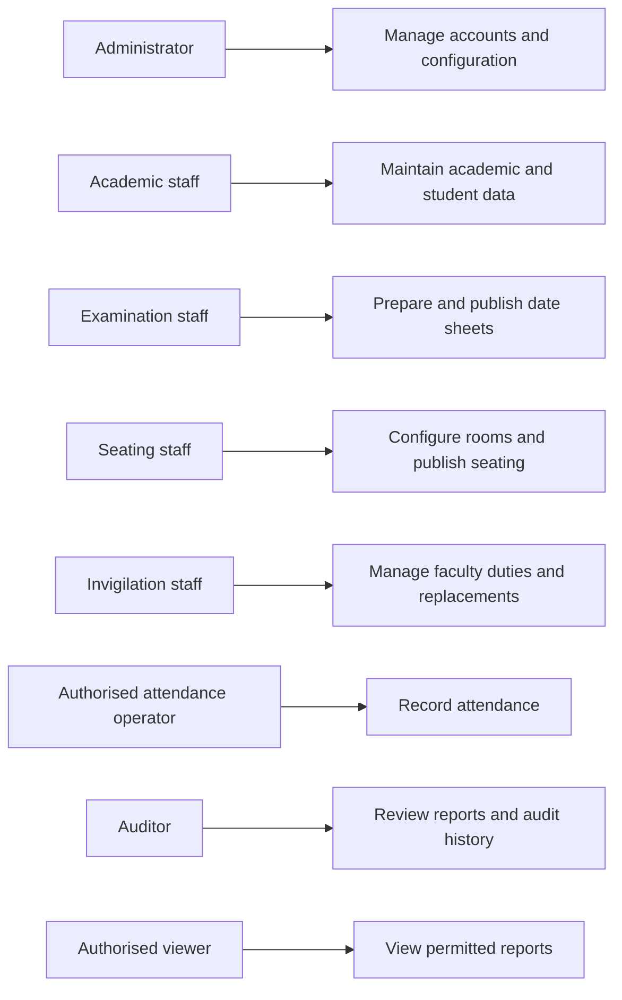
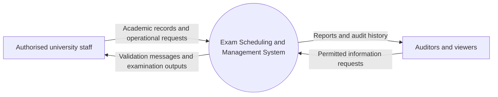
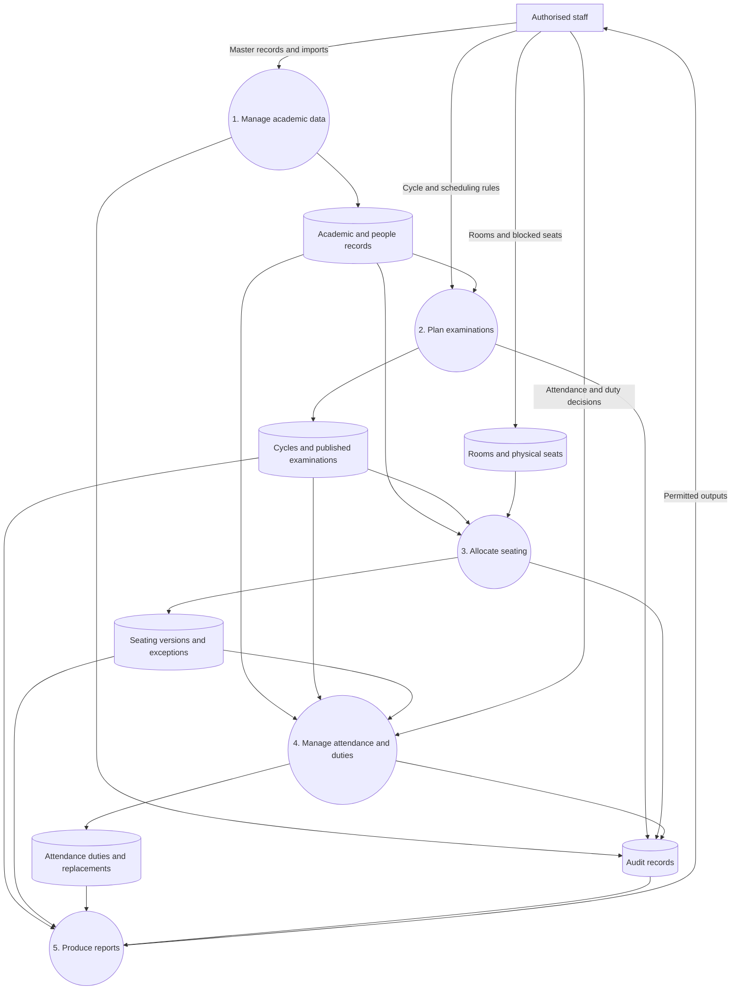
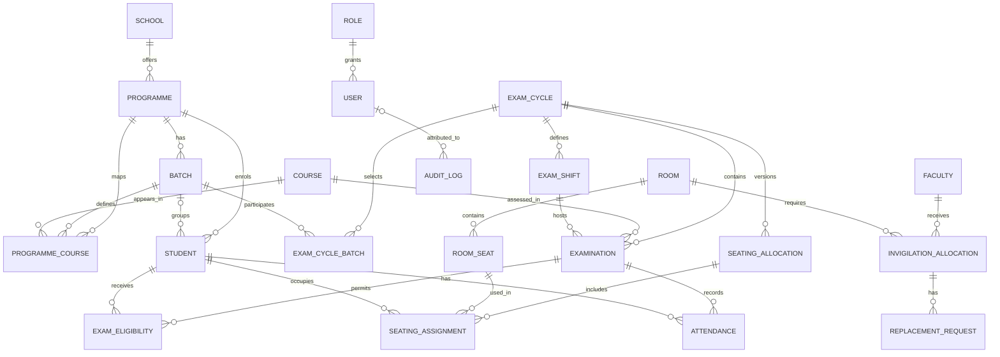
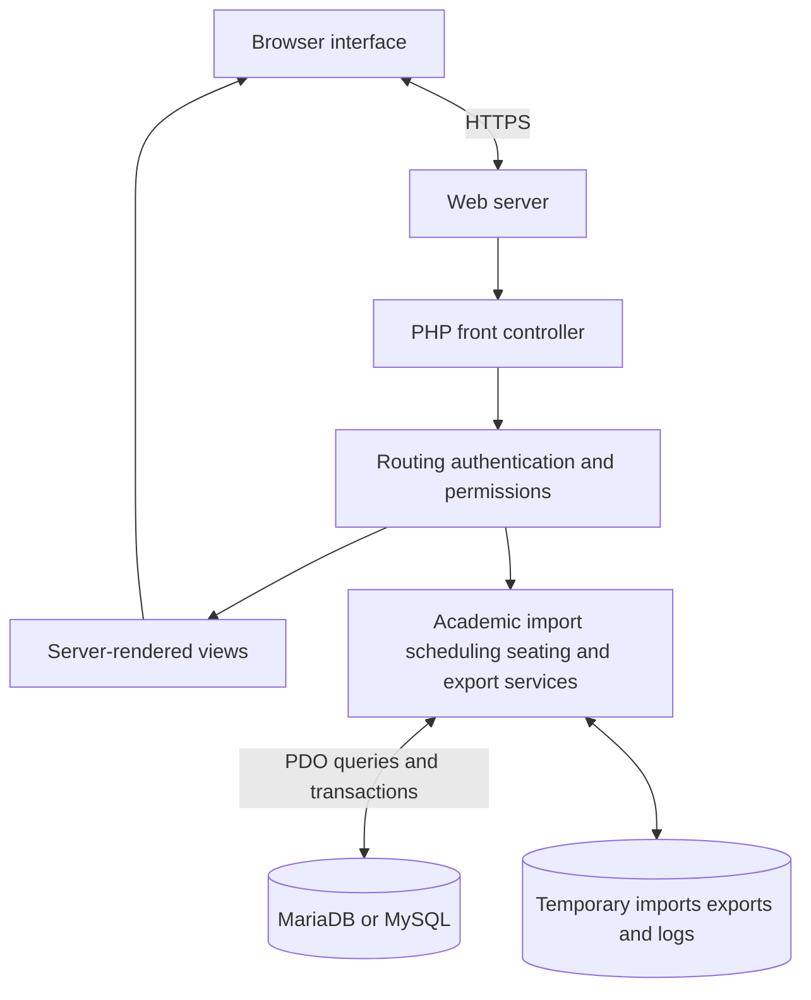

# Software Requirements Specification (SRS)

## Exam Scheduling and Management System

**Institution:** Gautam Buddha University  
**Document version:** 1.0  
**Prepared on:** 30 September 2026  
**Status:** Draft for stakeholder review

This document explains what the Exam Scheduling and Management System should do, who will use it, and how its requirements will be checked. It follows the existing project documentation, database design, and application code. It is a requirements baseline, rather than a claim that every requirement has already passed testing. Proposed service targets and decisions that still need agreement are identified explicitly.

## 1. Introduction

### 1.1 Purpose

The Exam Scheduling and Management System helps the university organise examinations through one coordinated system. This SRS gives the examination cell, academic staff, developers, and testers a shared understanding of the expected behaviour. It also provides a basis for reviewing changes and deciding whether the system is ready for use.

### 1.2 Project Scope

The system covers academic master records, students, faculty, examination cycles, date sheets, rooms, seating plans, attendance, invigilation duties, replacements, reporting, and audit history.

Its purpose is to reduce repeated spreadsheet work, make scheduling and allocation more consistent, and help staff identify problems before an examination takes place. For example, when a room has fewer usable seats than expected, the system should report the affected students rather than silently omit them.

Online examination delivery, question-bank management, answer evaluation, marks processing, fee collection, and public student self-service are outside this specification. They would require separately agreed requirements.

### 1.3 Intended Audience

- University management and the Controller of Examinations, who approve operational requirements.
- Academic, seating, and invigilation coordinators, who prepare and review examination information.
- Administrators, who manage access, configuration, and deployment.
- Developers and testers, who implement and verify the requirements.
- Auditors and authorised viewers, who review records and reports.

### 1.4 Definitions and Acronyms

| Term | Meaning |
|---|---|
| SRS | Software Requirements Specification. |
| FR / NFR | Functional requirement / non-functional requirement. |
| Examination cycle | A defined examination period with its academic session, type, dates, shifts, and participating batches. |
| Batch | Students admitted to a programme during a particular admission year. |
| Cohort | A group identified by programme, batch, semester, and section. |
| Shift | A configured examination time slot. |
| Date sheet | The examination timetable showing papers, dates, and shifts. |
| Eligibility | A student's recorded permission to take a particular examination. |
| Blocked seat | A physical seat that cannot be allocated. |
| Draft / Published | A working version / an officially released operational version. |
| CSV / XLSX | Supported spreadsheet formats for imports and exports. |
| RBAC | Role-based access control. |
| CSRF | Cross-site request forgery, a type of unauthorised browser request. |
| DFD / ER | Data-flow diagram / entity-relationship model. |

### 1.5 References

The following project files provide the source material for this specification:

- [Project overview](../README.md).
- [Operator guide](../OPERATOR_GUIDE.md).
- [Database schema](../database/schema.sql).
- [Security baseline](../SECURITY.md).
- [Role policy](../app/Auth/RolePolicy.php).
- [Application routes and validation](../app/Foundation/Application.php).
- [Automatic scheduling documentation](AUTOMATIC-SCHEDULING.md).
- [Deployment guidance](../DEPLOYMENT.md).

No external certification or formal standards compliance is asserted by this document.

## 2. Overall Description

### 2.1 Product Perspective

The Exam Scheduling and Management System is a browser-based university application backed by a central relational database. It connects academic data with examination operations so that staff can move from curriculum preparation to scheduling, seating, attendance, and reporting without maintaining separate versions of the same information.

The current application uses PHP and server-rendered pages. It can run locally through XAMPP or on a compatible hosted environment.

### 2.2 Product Functions

The main functions are to maintain records, validate spreadsheet imports, prepare examination calendars, generate and review date sheets, allocate physical seats, prepare attendance sheets, allocate faculty duties, handle replacements, and export operational reports. Audit records support accountability for important changes.

### 2.3 User Classes

| User class | Responsibility and intended access |
|---|---|
| System Administrator | Full access to configuration, users, academic records, operations, and audit history. |
| Controller of Examinations | Examination cycles, date sheets, seating, attendance, and operational reports. |
| Academic Coordinator | Schools, programmes, curriculum, students, and reports. |
| Seating Coordinator | Rooms, seat layouts, seating plans, and reports. |
| Invigilation Coordinator | Faculty, availability, duty allocation, replacements, attendance, and reports. |
| Faculty / Invigilator | Restricted authenticated dashboard under the current role policy. |
| Audit and Compliance Viewer | Read-only reports and audit history. |
| Authorised Read-only Viewer | Dashboard and permitted reports. |

**Access policy decision:** The role policy grants operational permissions to several coordinator roles, while `SECURITY.md` describes a boundary that rejects non-administrator changes. The inspected routing code uses role permissions. Stakeholders must confirm the intended write-access policy, and code, documentation, and tests must agree before approval. Faculty attendance entry or replacement self-service must not be assumed from the role name alone.

### 2.4 Operating Environment

- PHP 8.2 or newer, with PDO MySQL and ZIP support.
- MariaDB 10.4 or newer, or MySQL 8 or newer.
- Apache with rewrite support, or a compatible web-server deployment.
- Browser access on desktop, tablet, and mobile devices.
- HTTPS for production use.
- Storage for temporary imports, exports, logs, and managed backups.

The supported browser versions and production server capacity must be recorded in the deployment acceptance plan.

### 2.5 Constraints

- Academic data must follow the university's school, programme, batch, and identifier conventions.
- Imports are limited to CSV and XLSX, with a 10 MB application-level limit. XLSX imports read the first worksheet.
- Server upload and execution limits must support the agreed workloads.
- Seating capacity is limited by actual usable seats, including blocked-seat exclusions.
- Automated scheduling cannot create extra examination days or resolve missing curriculum data without staff action.
- Published seating is versioned; corrections require a new operational version rather than editing the released plan in place.

### 2.6 Assumptions and Dependencies

Staff will supply accurate curriculum, student, room, and faculty records. University authorities will confirm holidays, examination dates, and scheduling policies. The hosting environment will provide a working database, secure sessions, and sufficient storage. Administrators will arrange backups and restoration procedures.

Draft date-sheet generation does not depend on student records being present. However, meaningful eligibility counts, seating, and attendance depend on matching student data.

## 3. System Features

### 3.1 Authentication

Users sign in with an active account. The system checks credentials, establishes a session, and controls access to protected pages. Invalid sign-in attempts receive a clear message. Logout and inactivity expiry end access through that session.

### 3.2 User Management

Administrators create accounts, assign a defined role, change account status, and replace passwords. The system prevents an administrator from deactivating their own signed-in account or removing their own administrator role through the account form.

### 3.3 Search

Users can search the student register by name, roll number, enrollment number, or mobile number, and narrow results by programme and batch. Curriculum screens provide programme, batch, and semester filters. Search and filtering operate within the user's permitted modules; a global search across every module is not specified.

### 3.4 Academic and People Records

The system maintains schools, departments, programmes, batches, courses, curriculum mappings, students, and faculty. Curriculum is associated with a specific batch, semester, and section so that the right papers are selected for each examination cycle.

### 3.5 Examination Planning and Date Sheets

Staff define examination cycles, shifts, calendars, and participating batches. Papers can be scheduled manually, imported, or generated automatically. Automatic scheduling supports school-based scope, selected written papers, priority, preferred gaps, review, locked placements, regeneration, approval, and publication.

### 3.6 Rooms and Seating

Staff configure room geometry, capacity, seat order, and blocked seats. The allocator creates a versioned plan for a date and shift, checks seating validity, and reports students who could not be allocated.

### 3.7 Attendance, Invigilation, and Replacements

Published seating provides the basis for room-wise attendance sheets. Attendance can be marked and corrected by authorised users. Duty allocation considers faculty availability and existing assignments. Replacement requests retain their reason and review outcome.

### 3.8 Imports, Reports, and Audit

Spreadsheet imports follow an upload, validation, preview, and commit workflow. Reports support the available CSV, date-sheet XLSX, and printable views. Audit history records supported operational changes and the responsible account.

## 4. Functional Requirements

“Shall” identifies a required behaviour. All changes described below are subject to the final approved access policy.

| ID | Requirement |
|---|---|
| FR-01 | The system shall authenticate active users using a username and password and reject invalid credentials, inactive accounts, and locked accounts. |
| FR-02 | The system shall restrict protected routes according to the approved role permissions, including direct URL access. |
| FR-03 | The system shall support logout and expiry after the configured period of inactivity. |
| FR-04 | The system shall allow administrators to create and update accounts, roles, statuses, and passwords while protecting their own active administrator access. |
| FR-05 | The system shall maintain schools, programmes, admission batches, courses, and batch-specific curriculum mappings. |
| FR-06 | The system shall maintain student records, including identifiers, programme, batch, academic session, semester, section, and status. |
| FR-07 | The system shall search student records by supported identifiers, name, or mobile number and provide programme/batch filters and paginated results. |
| FR-08 | The system shall maintain faculty records and date/shift availability. |
| FR-09 | The system shall accept supported CSV/XLSX imports for programmes, courses, students, faculty, rooms, and date sheets, subject to the file-size limit. |
| FR-10 | The system shall show accepted and rejected import rows with row-specific validation messages before commit and shall exclude invalid rows from committed records. |
| FR-11 | The system shall maintain rooms, physical seat coordinates, allocation order, room status, and blocked-seat information. |
| FR-12 | The system shall create examination cycles with academic session, examination type, date range, paper duration, shifts, and selected batches. |
| FR-13 | The system shall maintain the cycle calendar, including holidays, Sundays, preparation days, and blocked dates. |
| FR-14 | The system shall support manual and imported date-sheet entries and reject invalid cycle dates, shifts, and cohort conflicts. |
| FR-15 | For regular, mid-semester, and end-semester cycles, the system shall derive the applicable semester for each active batch and reject completed or not-yet-started batches. |
| FR-16 | The system shall generate an automatic draft using the selected school, programmes, batches, written papers, calendar, daily paper limit, and scheduling preferences. |
| FR-17 | The system shall exclude lab/practical papers from automatic written scheduling and retain deliberate paper selections when filters change. |
| FR-18 | The system shall show validation blockers and warnings, together with reasons for papers that cannot be scheduled. |
| FR-19 | The system shall support reviewing, moving, and locking draft papers and shall preserve locked placements during regeneration of unlocked papers. |
| FR-20 | The system shall support approval and publication of a reviewed automatic date-sheet run and retain the responsible account and timestamps. |
| FR-21 | The system shall generate versioned seating for an examination date and shift using eligible students and the selected usable room seats. |
| FR-22 | The system shall reject duplicate student assignments, duplicate seat use, blocked-seat use, and ineligible student assignments within an allocation. |
| FR-23 | The system shall list unallocated students and their reasons when capacity or allocation rules prevent seating. |
| FR-24 | The system shall permit reasoned corrections to draft seating, validate before publication, and preserve published seating as an immutable operational version. |
| FR-25 | The system shall create attendance records from published seating and support Unmarked, Present, Absent, Unfair Means, Withheld, and Other statuses. |
| FR-26 | The system shall retain the responsible user and time for attendance marking and corrections. |
| FR-27 | The system shall allocate invigilation duties while excluding unavailable faculty and preventing multiple faculty assignments in the same date/shift. |
| FR-28 | The system shall record replacement requests, reasons, nominated replacements, review outcomes, and reviewer details, while enforcing session-conflict checks. |
| FR-29 | The system shall provide permitted operational CSV reports, date-sheet XLSX exports, and printable seating and attendance views. |
| FR-30 | The system shall record significant supported changes in audit history and restrict audit access to authorised roles. |
| FR-31 | The system shall handle deletion of related records through explicit dependency checks or defined transactional cleanup, preventing orphaned operational data. |

## 5. Non-Functional Requirements

These requirements distinguish required controls from **proposed acceptance targets**. Numerical targets have not been established by benchmark testing in this document.

### 5.1 Performance

**NFR-P01 — Proposed target:** At least 95% of ordinary dashboard and register requests should complete within three seconds with 50 concurrent authenticated sessions and a reference dataset of 10,000 students. This excludes imports, scheduling generation, seating generation, and exports. Server specifications and the network measurement boundary must be agreed before testing.

**NFR-P02:** Student registers shall use pagination. Long operations shall report completion or a useful failure message. Baseline durations for imports, scheduling, seating, and exports shall be measured against an agreed representative examination cycle before release; no duration guarantee is implied yet.

### 5.2 Security

**NFR-S01:** Passwords shall be stored using secure password hashing and verified without storing plaintext credentials. New and replacement account passwords shall contain at least 12 characters, consistent with the current account validation.

**NFR-S02:** State-changing browser requests shall require a valid CSRF token. Database queries shall use parameterised statements for untrusted values, and displayed user-controlled content shall be escaped appropriately.

**NFR-S03:** Sessions shall use HTTP-only cookies, SameSite protection, configurable inactivity expiry, and secure cookies in HTTPS production deployments. Session identifiers shall be regenerated after successful authentication.

**NFR-S04:** The system shall temporarily pause further sign-in attempts after repeated failures. The current session-based policy pauses sign-in for 60 seconds after five failures; it is not an account-wide or network-wide lockout.

**NFR-S05:** Production deployments shall disable debug output, protect credentials and backups from public access, and use a dedicated database account with the permissions required by the application.

### 5.3 Scalability

**NFR-SC01:** The system shall support multiple schools, programmes, batches, rooms, and examination cycles without hard-coding their counts into operational workflows.

**NFR-SC02:** Growth in data and concurrent usage shall be evaluated through representative load tests. Maximum supported capacity remains a deployment-specific acceptance decision.

### 5.4 Reliability

**NFR-R01:** Critical multi-record commits and publication operations shall use transactions so that failures do not leave partially committed operational records.

**NFR-R02:** With identical inputs, rules, and seed where applicable, automated allocation shall produce reproducible results.

**NFR-R03 — Proposed operational targets:** Daily database backups should provide a recovery point of no more than 24 hours. A tested restoration procedure should restore service within four hours. These depend on hosting, backup storage, and administrator arrangements and require operational approval.

### 5.5 Usability

**NFR-U01:** Screens shall use consistent terminology, labelled fields, readable tables, and clear success and error messages. Import errors shall identify the affected row and explain what needs correction.

**NFR-U02:** Staff shall be able to review drafts and validation results before publication. Interfaces shall adapt to desktop and mobile layouts, and printable reports shall preserve essential examination information.

### 5.6 Accessibility

**NFR-A01:** Main workflows shall provide keyboard access, visible focus, associated form labels, and meaningful text descriptions. Error and status information shall not rely on colour alone.

**NFR-A02 — Proposed target:** Main workflows should meet WCAG 2.2 Level AA following an accessibility audit. Compliance has not been verified; the agreed workflow list and audit method must be included in acceptance planning.

## 6. External Interface Requirements

### 6.1 User Interface

The browser interface shall provide sign-in, a role-aware dashboard, academic and people registers, import previews, examination planning, calendar and scheduling review, room layouts, seating previews, attendance, duty allocation, replacements, reports, and audit views as permitted.

Dates, programme codes, batch labels, shifts, and statuses shall be presented consistently. Official outputs shall include enough cycle, date, shift, room, and student information for their intended use. Staff may save printable pages as PDF using browser printing; a dedicated PDF generation service is not assumed.

### 6.2 APIs

The current system primarily uses internal HTTP routes, browser forms, and selected JSON responses. The `/health` route reports application and database status. This specification does not promise a public REST API, external API authentication scheme, or third-party integration contract.

Any future integration shall define its data format, authentication, permissions, error handling, and ownership before implementation.

### 6.3 Third-party Services

Core workflows depend on the web host and MariaDB/MySQL database. CSV/XLSX files provide a practical exchange interface with existing academic spreadsheets. Email, SMS, university ERP, single sign-on, payment, and cloud-storage integrations are not required by the current scope.

## 7. Data Requirements

### 7.1 Database Requirements

The system shall use a relational database with primary keys, foreign keys, uniqueness constraints, and indexes for frequently accessed records. Related operations shall maintain referential integrity. The canonical schema currently defines 35 tables.

Operational versions, attendance history, replacement reviews, and audit records shall be retained according to an approved university policy. Retention periods and archival responsibilities remain to be agreed.

### 7.2 Data Entities

| Domain | Main entities and information |
|---|---|
| Identity | Roles, users, account status, audit logs, settings. |
| Academic | Schools, departments, programmes, batches, courses, programme-course mappings. |
| People | Students, faculty, faculty availability. |
| Infrastructure | Rooms, capacities, physical seat coordinates, blocked-seat flags. |
| Examinations | Cycles, selected batches, shifts, calendar dates, examinations, cohorts, eligibility. |
| Scheduling | Rules, runs, run items, validation results, conflicts, approval/publication details. |
| Seating | Allocation versions, student-seat assignments, unallocated exceptions. |
| Examination operations | Attendance, invigilation allocations, replacement requests. |
| Imports | Import batches, source rows, normalised rows, validation errors. |

### 7.3 Relationships

A school offers programmes, and each programme has admission batches. Courses are connected to programmes and batches through curriculum mappings. Students belong to programmes and, where assigned, batches.

An examination cycle selects batches and defines shifts and calendar dates. Each examination references a course, cycle, date, and shift; cohort and eligibility records identify participating groups and students.

A room contains physical seats. A seating allocation version contains student-seat assignments and unallocated exceptions. Attendance connects the student and examination to the seating context. Faculty availability and duty allocations reference examination sessions, and replacement requests reference existing duties.

### 7.4 Validation Rules

- Required names, codes, identifiers, dates, and relationships must be supplied for the relevant operation.
- Usernames must follow the configured format and be unique. Supplied account email addresses must be valid and satisfy database uniqueness rules.
- Academic sessions must use consecutive years, such as `2026-2027`.
- Standard student roll numbers follow the university's nine-character convention, such as `235UCS001`; enrollment numbers are separate identifiers. Import validation must report unrecognised or ambiguous mappings.
- Programme duration must be between 1 and 20 semesters under current validation.
- A selected batch, programme, semester, and section must form a valid curriculum scope.
- Examination dates and shifts must belong to the selected cycle and satisfy calendar and duration checks.
- Subject priority must be within 1–100; lower values indicate earlier preference when priority scheduling is enabled.
- Room coordinates must be unique within a room, and usable capacity must not exceed physical capacity.
- An allocation must not assign the same student twice or occupy the same seat twice.
- Attendance must use the defined status values and remain unique for each examination/student pair.
- Faculty must not hold conflicting duties in the same date/shift.
- Import rows must be validated before commit; ambiguous batch aliases must not be silently assigned.

## 8. Use Cases / User Stories

The actors below describe operational responsibilities. Execution requires an account permitted by the approved access policy.

| ID | Actor and goal | Preconditions | Main flow | Exception and outcome |
|---|---|---|---|---|
| UC-01 | User signs in securely. | An account exists. | Enter credentials; system verifies account; dashboard opens. | Invalid or inactive account is rejected; repeated failures trigger a pause. |
| UC-02 | Academic staff imports students. | Programme/batch data and a permitted account exist. | Upload file; review validation; commit accepted rows. | Invalid rows show reasons and are excluded from commit. |
| UC-03 | Examination staff prepares a date sheet. | Cycle, shifts, calendar, and curriculum exist. | Select scope and papers; validate; generate; review; approve; publish. | Blocking conflicts prevent progression; infeasible papers show reasons. |
| UC-04 | Seating staff publishes a seating plan. | Published examinations, eligibility, and usable rooms exist. | Select session/rooms; generate; review; resolve exceptions; validate; publish. | Insufficient capacity identifies unallocated students; invalid seating cannot be published. |
| UC-05 | Authorised attendance operator records attendance. | Published seating and attendance records exist. | Open room sheet; mark students; save; correct when necessary. | Invalid statuses or unauthorised changes are rejected; correction metadata is retained. |
| UC-06 | Invigilation staff assigns duties and replacements. | Faculty availability and an examination session exist. | Allocate duties; submit a replacement reason; review a suitable replacement. | Unavailable or already-booked faculty cannot be assigned to conflicting duties. |
| UC-07 | Auditor reviews an operational change. | Account has audit permission. | Open history; inspect action, entity, account, and time. | Unauthorised access is denied. |

Representative user stories:

- As examination staff, I want to see scheduling conflicts before publication so that I can correct the timetable before staff rely on it.
- As seating staff, I want unusable seats excluded automatically so that students receive valid physical seats.
- As academic staff, I want import errors explained by row so that I can correct the source file efficiently.
- As an auditor, I want to identify who changed an operational record and when so that examination decisions can be reviewed.

## 9. System Models

These diagrams summarise the requirements. They are conceptual models rather than a complete physical schema or formal UML notation. Role connections describe responsibilities subject to the access-policy decision.

### 9.1 Use Case Diagram

### 9.2 DFD

**Level 0 — Context:**

**Level 1 — Main data flow:**

### 9.3 ER Diagram

The following is a simplified view of the principal database relationships. Optional associations and supporting tables are omitted for readability.

### 9.4 Architecture Diagram

## 10. Business Rules

| ID | Rule |
|---|---|
| BR-01 | Operational access follows the approved role policy; sensitive actions require server-side authorisation. |
| BR-02 | A cycle must identify participating batches before batch-based scheduling. |
| BR-03 | Regular, mid-semester, and end-semester examinations use each active batch's applicable current semester. Historical semester selection belongs to appropriate back-paper or special cycles. |
| BR-04 | Lab and practical courses are excluded from automatic written date sheets. |
| BR-05 | Sundays and holidays are unavailable unless explicitly enabled as examination days. |
| BR-06 | A preferred rest gap is a scheduling preference. It may be relaxed when the examination window cannot accommodate it; hard calendar and conflict rules remain binding. |
| BR-07 | Different independent cohorts may share a date/shift when no relevant conflict exists. |
| BR-08 | Locked papers retain their placement during regeneration; new generation must preserve existing papers outside the intended scope. |
| BR-09 | Students must be eligible for the examination to receive an associated seating assignment. |
| BR-10 | Blocked seats cannot be allocated, and one allocation cannot contain duplicate students or occupied seats. |
| BR-11 | Unallocated students must remain visible as exceptions; they must not disappear from the operational count. |
| BR-12 | Published seating is an official version; subsequent changes require a new version. Draft manual corrections require a reason. |
| BR-13 | Faculty availability and existing session duties constrain invigilation and replacement assignments. |
| BR-14 | Invalid spreadsheet rows cannot be committed as valid records. |
| BR-15 | Deletion must respect dependencies and the specific controls for published or operational records. |

## 11. Acceptance Criteria

Acceptance testing shall use representative university data, valid and invalid input, each role, and both successful and failed workflows. These criteria define expected results; they are not a report of tests executed while preparing this SRS.

| ID | Verification scenario and expected result | Requirements |
|---|---|---|
| AC-01 | Valid active credentials open the dashboard; invalid, inactive, and locked accounts cannot sign in. Logout and configured inactivity expiry end access. | FR-01, FR-03 |
| AC-02 | Each approved role is tested against permitted and denied routes and direct state-changing requests. Denied requests leave data unchanged. Resolve the documented access-policy discrepancy before sign-off. | FR-02, FR-04, BR-01 |
| AC-03 | Academic, student, faculty, and room records can be maintained with valid values; invalid identifiers, relationships, and duplicate keys receive clear errors. Student search/filter results match the selected criteria. | FR-05–FR-08, FR-11 |
| AC-04 | A mixed valid/invalid CSV and first-worksheet XLSX import shows row-specific results and commits accepted rows only. Unsupported and oversized uploads are rejected. | FR-09, FR-10 |
| AC-05 | Cycle dates, shifts, batches, and calendar exclusions are enforced for manual, imported, and generated papers. Completed/future batches are rejected for regular cycles, and the correct current semester is selected. | FR-12–FR-18 |
| AC-06 | Filtering retains paper selections; lab/practical papers are excluded; locked placements survive regeneration. A reviewed run can be approved and published with actor/time records. | FR-17–FR-20 |
| AC-07 | Seating has no duplicate students, duplicate occupied seats, blocked-seat use, or ineligible assignments. An insufficient-capacity fixture lists every affected student with a reason. | FR-21–FR-23 |
| AC-08 | A draft seat correction requires a reason. Invalid seating cannot be published. A published plan cannot be changed in place; regeneration creates a new version. | FR-24 |
| AC-09 | Published seating produces matching attendance records. Permitted marking and correction save the defined statuses and responsible user/time. | FR-25, FR-26 |
| AC-10 | Unavailable or booked faculty cannot receive a conflicting duty or replacement. Replacement review retains the decision and reviewer information. | FR-27, FR-28 |
| AC-11 | CSV/XLSX and print outputs agree with selected database records. Supported audited changes appear with the responsible user, action, entity, and timestamp. | FR-29, FR-30 |
| AC-12 | Attempted deletion of dependent records follows the defined guard or cleanup path and leaves no orphaned records. Simulated transaction failure leaves no partial publication or commit. | FR-31, NFR-R01 |
| AC-13 | Password storage, CSRF rejection, session controls, protected-route access, and production configuration pass security verification. | NFR-S01–NFR-S05 |
| AC-14 | The agreed workload passes the approved response-time target; longer operations have measured baselines. A backup restoration exercise meets the approved recovery targets. | NFR-P01, NFR-P02, NFR-R03 |
| AC-15 | Main workflows pass keyboard, label, focus, and error-message checks. Any agreed accessibility target is assessed through the approved audit. | NFR-U01, NFR-U02, NFR-A01, NFR-A02 |

Approval requires completed acceptance evidence, resolution of material access and data-integrity issues, and agreement on the proposed service targets. Unresolved deviations must be documented with their impact and an agreed decision.

## 12. Appendices

### Appendix A: Typical Examination Workflow

1. Prepare schools, programmes, batches, and curriculum.
2. Import and review students and faculty.
3. Configure rooms and mark unusable seats.
4. Create the examination cycle, shifts, and calendar.
5. Select written papers, validate, generate, and review the date sheet.
6. Approve and publish the reviewed schedule.
7. Generate seating, resolve exceptions, validate, and publish.
8. Prepare attendance sheets and allocate invigilation duties.
9. Record attendance and review necessary replacements.
10. Export reports, review audit records, and archive according to policy.

### Appendix B: Decisions Required Before Final Approval

| Decision | Suggested owner |
|---|---|
| Confirm staff write permissions and reconcile the security guide with role policy and implementation. | System owner and administrator. |
| Agree production capacity, browser support, workload dataset, and performance measurement conditions. | Technical and examination teams. |
| Approve backup schedule, recovery targets, restoration ownership, and storage arrangements. | Infrastructure administrator. |
| Define retention and archival periods for personal data, imports, operational records, and audit history. | University administration and data owner. |
| Confirm accessibility audit scope and proposed conformance target. | Product owner and testing team. |
| Confirm whether faculty need duties, attendance entry, or replacement self-service beyond the current restricted dashboard. | Examination and invigilation authorities. |

### Appendix C: Document Maintenance

Changes shall retain requirement identifiers where practical. Revised behaviour, business rules, and acceptance criteria must be updated together. Each approved revision should record its date, owner, and material changes.

| Version | Date | Description |
|---|---|---|
| 1.0 | 30 September 2026 | Initial project-grounded SRS following the requested twelve-section structure. |
